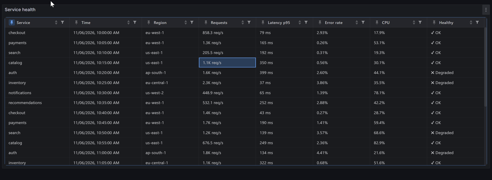
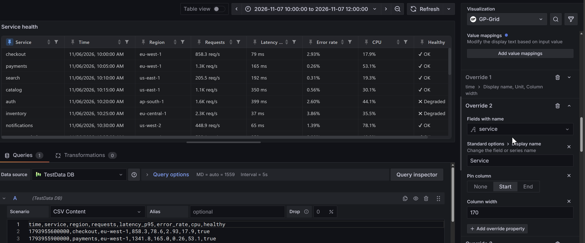
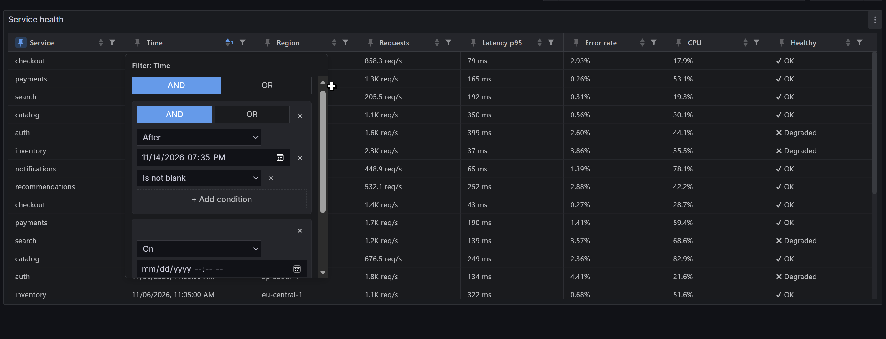

# GP-Grid

A fast, virtualized data grid panel for Grafana, built on [gp-grid](https://github.com/GioPat/gp-grid).

GP-Grid shows query results as a spreadsheet-like grid that stays responsive with large result sets. Cells are read straight from the Grafana data frame without copying rows, and values are formatted with Grafana's units, decimals and value mappings.

## Requirements

- Grafana 11.6.11+, 12.0.10+, 12.1.7+, 12.2.5+ or 12.3 and later

## Getting started

1. Add a new visualization to a dashboard and select **GP-Grid**.
2. Pick any data source query that returns a table or time series.
3. If the query returns several data frames, choose which one to display with **Frame index**.

## Panel options

| Option         | Description                                | Default |
| -------------- | ------------------------------------------ | ------- |
| Frame index    | Which query result (data frame) to display | `0`     |
| Row height     | Row height in pixels                       | `32`    |
| Column sorting | Sort by clicking a column header           | On      |
| Column filters | Show a filter on each column header        | On      |

## Field options

Standard options **Unit**, **Decimals**, **Display name**, **No value** and **Value mappings** change how cells are formatted. Use overrides to apply them to individual columns.

| Option       | Description                                   | Default |
| ------------ | --------------------------------------------- | ------- |
| Column width | Column width in pixels                        | `150`   |
| Pin column   | Keep the column fixed at the start or the end | None    |
| Hide column  | Leave the column out of the grid              | Off     |

## Column types

- **Number** columns get numeric filters.
- **Boolean** columns get boolean filters.
- **Time** columns, and number columns with a date unit such as _Datetime local_, get date filters and sort chronologically. They are shown in the unit's date format.
- **Other** columns, such as JSON objects, are shown as JSON text.
- Every other column type uses text filters.

